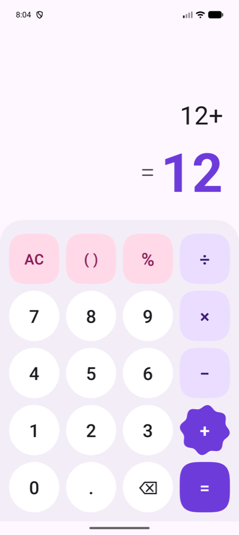
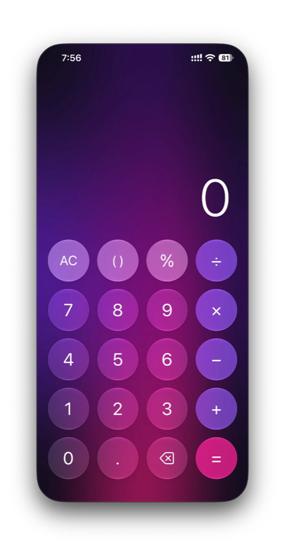

[](https://opensource.org/licenses/Apache-2.0)
[](https://apps.apple.com/app/id6830056185)
[](https://play.google.com/store/apps/details?id=com.jesusdmedinac.compose.calculator)

# Compose Calculator

A fast, private, ad-free calculator for Android and iPhone. The calculation engine is shared Kotlin
code, and each platform gets a fully native UI: **Material 3 Expressive** in Jetpack Compose on
Android, and **Liquid Glass** in SwiftUI on iOS.

<p>
  <a href="https://play.google.com/store/apps/details?id=com.jesusdmedinac.compose.calculator">
    
  </a>
  &nbsp;
  <a href="https://apps.apple.com/app/id6830056185">
    
  </a>
</p>

<p>
  <a href="https://apps.apple.com/app/id6830056185">
    
  </a>
  &nbsp;&nbsp;
  <a href="https://play.google.com/store/apps/details?id=com.jesusdmedinac.compose.calculator">
    
  </a>
</p>

## Features

- Addition, subtraction, multiplication, division, modulo (`%`), automatic parentheses and
  step-by-step delete.
- Exact decimal arithmetic with 20 significant digits, so `0.1 + 0.2` is `0.3` and large numbers
  keep every digit.
- Live result preview while typing, and the last calculation shown above the result.
- Fully offline, no ads, no accounts and no permissions.
- Light and dark themes in the violet and magenta brand palette.
- Portrait only for now. A landscape scientific mode is planned.

### Android: Material 3 Expressive

- Number keys are circles and the other keys are squircles, all drawn with one morphing shape.
- The active operator turns into a slowly rotating "cookie" shape.
- Keys squish on press with a springy bounce, and neighbors in the same row move aside.
- Result digits roll in like a mechanical counter, `=` bounces the result into place, and `AC`
  sweeps a wave of color across the display.

### iOS: Liquid Glass

- Glass keys in a `GlassEffectContainer`, tinted by role, over a native `MeshGradient`.
- Numeric content transitions for the result and light haptic feedback on every tap.

## Architecture

```
shared (Kotlin Multiplatform)
├── commonMain   CalculatorEngine (StateFlow), Keypad, ExprK expression parser,
│                and the Compose UI used by Android
├── commonTest   engine tests
├── androidMain  MainView entry point for Android
└── iosMain      CalculatorBridge, which lets Swift observe the engine

androidApp       MainActivity hosting the Compose UI
iosApp           SwiftUI app: CalculatorGlassView driven by CalculatorBridge
```

- `CalculatorEngine` exposes its state as a `StateFlow<CalculatorState>`. Compose collects it with
  `collectAsState()`, and Swift observes it through `CalculatorBridge.watch(onChange:)`.
- Expressions are evaluated by a vendored copy of [ExprK](https://github.com/Keelar/ExprK) on top
  of [kotlin-multiplatform-bignum](https://github.com/ionspin/kotlin-multiplatform-bignum).
- The keypad shows `÷ × −`, and the engine maps them to `/ * -` before evaluating.

### Key files

| Path | What it holds |
| --- | --- |
| `shared/src/commonMain/.../ui/model/CalculatorEngine.kt` | Engine, state and evaluation |
| `shared/src/commonMain/.../ComposeCalculatorApp.kt` | Compose screen, keypad and animations |
| `shared/src/commonMain/.../ui/compose/MorphingKeyShape.kt` | Circle, squircle and cookie key shape |
| `shared/src/commonMain/.../ui/compose/RollingText.kt` | Rolling digits for the result |
| `shared/src/commonMain/.../ui/Theme.kt`, `Color.kt` | Material 3 theme and brand palette |
| `shared/src/iosMain/kotlin/CalculatorBridge.kt` | Swift-facing wrapper around the engine |
| `iosApp/iosApp/CalculatorGlassView.swift` | SwiftUI Liquid Glass screen |
| `design/compose-calculator.pen` | App icon, Android and iOS designs (pen.dev) |

## Requirements

- macOS (needed for the iOS app)
- JDK 17
- Android SDK with API 36 installed (`targetSdk 36`, `minSdk 24`)
- Xcode 26 or later with the iOS 26 SDK. The iOS app targets iOS 26.6 and runs on iPhone only.

## Build and run

### Android

The Android build reads its signing configuration from `keystore.properties` in the project root,
even for debug builds, so that file must exist before Gradle can configure the app.

```bash
./gradlew :androidApp:installDebug
```

### iOS

Open `iosApp/iosApp.xcodeproj` in Xcode, select an iPhone and run the `iosApp` scheme. The Xcode
build runs Gradle to compile the shared framework first.

To build from the terminal for a connected iPhone (replace the device ID with yours from
`xcrun devicectl list devices`):

```bash
xcodebuild -project iosApp/iosApp.xcodeproj -scheme iosApp -destination id=<device-id> -allowProvisioningUpdates build
```

> **Note**
> If a custom Swift toolchain is selected in Xcode, the build can fail with
> `Unknown argument: '-target-arch-variant'`. Select the default Xcode toolchain, or prefix the
> command with `TOOLCHAINS=com.apple.dt.toolchain.XcodeDefault`.

## Tests

The engine tests live in `shared/src/commonTest` and run on the JVM:

```bash
./gradlew :shared:testDebugUnitTest
```

## Release

### Google Play

```bash
./gradlew :androidApp:bundleRelease
```

```bash
./verify-release-aab.sh
```

The script checks the package name, target SDK, version, minimum SDK and signature of
`androidApp/build/outputs/bundle/release/androidApp-release.aab`. See
[GOOGLE_PLAY_GUIDE.md](GOOGLE_PLAY_GUIDE.md) for the full publishing playbook. Store texts,
release notes and images are in `fastlane/metadata/android`.

The phone screenshots come from `StoreScreenshotsTest` in `androidApp/src/androidInstrumentedTest`.
To regenerate them on a connected device or emulator, run:

```bash
bundle exec fastlane android screenshots serial:<adb-serial>
```

The lane captures at 1080×1920 (Play rejects screenshots longer than twice their width) and then
restores the device's screen size, density and dark mode.

> **Warning**
> The `Android prod CI` workflow builds and uploads to the Play internal track on every push to
> `main` (`bundle exec fastlane internal`). Bump `versionCode` in `androidApp/build.gradle.kts`
> before pushing, or Play rejects the upload.

### App Store

Archive and export the app from Xcode (**Product → Archive**, then **Distribute App → App Store
Connect**), and upload the `.ipa` with Xcode or Transporter. App Store listing texts are in
`iosApp/fastlane/metadata`.

The App Store screenshots come from `StoreScreenshotsUITests` in `iosApp/iosAppUITests`. fastlane
`snapshot` only drives simulators, so the lane runs the UI tests on a connected iPhone, exports
the screenshots they attach and scales them to each App Store size: `6.1_*.png` (1179×2556, for
the 6.1" and 6.3" slot) and `6.5_*.png` (1284×2778). `bundle exec fastlane ios export_screenshots`
re-exports the last run without the iPhone.

```bash
cd iosApp && bundle exec fastlane ios screenshots udid:<device-id>
```

On the iPhone, turn on **Settings → Developer → Enable UI Automation** and **Do Not Disturb**, and
keep the screen unlocked and on while it runs. Otherwise the screenshots come out black or show
notifications. The screenshots keep the device's real status bar.

## Privacy

The app collects no data. The privacy policy is published at
[compose-calculator.pages.dev/privacy-policy](https://compose-calculator.pages.dev/privacy-policy)
and kept in [PRIVACY_POLICY.md](PRIVACY_POLICY.md).

## License

Licensed under the [Apache License 2.0](LICENSE.txt).
